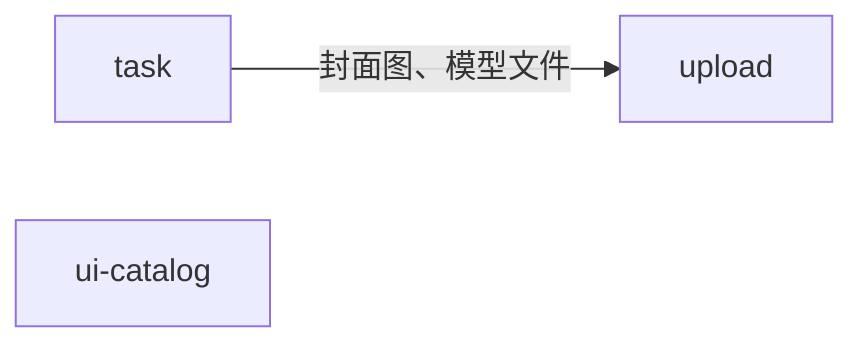

# Feature 划分

每个 feature 负责什么，以及哪些东西和它相邻、但归别处。新代码放进哪个 feature、什么时候新建 feature，见 [architecture.md 的 Feature boundaries](../.claude/rules/architecture.md#feature-boundaries)。

## 依赖

箭头从依赖方指向被依赖的 feature，标注依赖它做什么。

## task

负责：任务和它下面的评论、日志：列表、搜索、详情、创建、编辑、删除、重试、收藏、更换封面；generator 推进状态和进度。

不负责：

- 封面图和模型文件本身的上传和清理，归 upload；task 只决定任务用哪个文件当封面。

## upload

负责：为某个用途上传文件、把文件交给一条业务记录使用、清理没被使用的文件。

## ui-catalog

负责：设计系统组件的目录：每个组件的 Example 和源码。展示它的路由在 `app/` 里。
