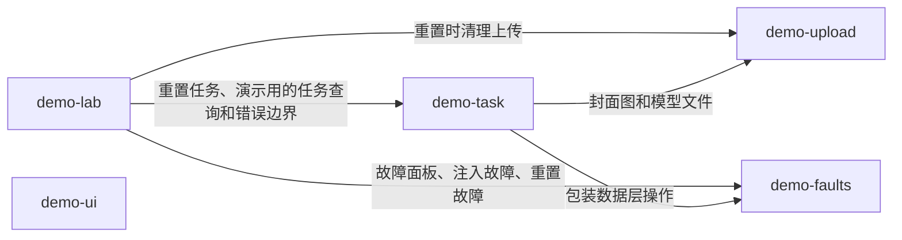

# Feature 划分

每个 feature 负责什么，以及哪些东西和它相邻、但归别处。新代码放进哪个 feature、什么时候新建 feature，见 [architecture.md 的 Feature boundaries](../.claude/rules/architecture.md#feature-boundaries)。

## 依赖

箭头从依赖方指向被依赖的 feature，标注依赖它做什么。

## demo-task

负责：Demo task 和它下面的评论、日志：列表、搜索、详情、创建、编辑、删除、重试、收藏、更换封面；Demo generator 推进状态和进度，以及它的时钟；任务的种子数据。

不负责：

- 封面图文件本身的上传和清理，归 demo-upload；demo-task 只决定任务用哪个文件当封面。
- 注入的故障、默认延迟和调用记录，归 demo-faults；demo-task 只把自己的每个操作交给它包装。
- `/demos/lab` 页面上的控制和演示，包括重置整个 Demo，归 demo-lab。

## demo-upload

负责：Demo upload：为某个用途上传文件、把文件交给一条业务记录使用、清理没被使用的文件。

## demo-faults

负责：Demo 数据层操作的故障机制：注入的故障、默认延迟、调用记录，它们怎样在服务端调用和 `/api/demo` 的 Route Handler 上生效，以及查看和修改它们的故障面板。

不负责：

- 故障面板放在哪个页面、页面上怎么介绍它，归 demo-lab。

## demo-lab

负责：`/demos/lab` 页面：放置故障面板、重置整个 Demo、draft mode，以及在注入的故障下演示查询状态、重试、并发失败和 Suspense 重置。

不负责：

- 故障面板本身和故障怎样生效，归 demo-faults。
- 重置时每份数据怎样恢复，归拥有它的 feature；demo-lab 只把各 feature 的重置放进同一个 transaction。

## demo-ui

负责：UI demo：设计系统组件的目录，以及每个组件的 Example。
